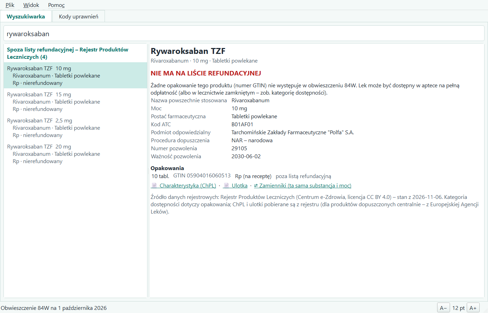
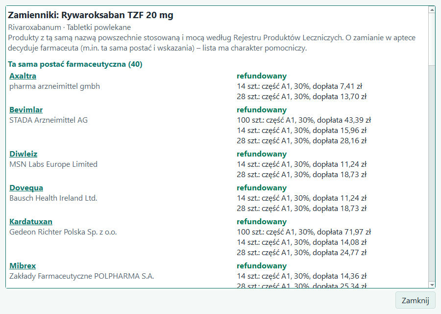

# Refundator

*Lista leków refundowanych – szybko i dokładnie.*

Refundator to program dla Windows, który odpowiada na pytanie: **czy lek jest na liście refundacyjnej Ministra Zdrowia, a jeśli tak – w jakich wskazaniach, z jaką odpłatnością i z jakimi uprawnieniami.** Dane pobiera prosto z obwieszczeń publikowanych na [gov.pl](https://www.gov.pl/web/zdrowie/obwieszczenia-ministra-zdrowia-lista-lekow-refundowanych), razem z załącznikami programów lekowych i chemioterapii oraz korektami (sprostowaniami i obwieszczeniami zmieniającymi).

## Co potrafi
- **Wyszukiwanie** po nazwie handlowej, substancji czynnej (także po polsku), numerze GTIN, **kodzie ICD-10** (np. `M31.3`) i **nazwie choroby** (np. „łuszczyca stawowa”).
- **Karta leku:** zakres refundacji raz, a pod nim zwarta tabela opakowań (także importów równoległych) – poziom odpłatności, dopłata pacjenta, cena, kategoria dostępności; szczegóły decyzji po rozwinięciu.
- **Uprawnienia S, DZ i C** (65+, do 18 lat, ciąża) przy każdym wskazaniu, którego dotyczą – z dopasowaniem „Uwag” listy DZ i ostrzeżeniem, gdy uwagi nie zgadzają się z treścią wskazań.
- **Programy lekowe i chemioterapia:** kody ICD-10 z załączników wraz z nazwami chorób, warunkami i pełnym opisem programu (kryteria kwalifikacji, dawkowanie, badania).
- **Korekty obwieszczeń** odczytywane z PDF i pokazywane **do zatwierdzenia** – każdą zmianę można sprawdzić ze źródłem i cofnąć.
- **Program aktualizuje się sam** – przy uruchomieniu pobiera i instaluje nową wersję (ze sprawdzeniem sumy kontrolnej).
- **Aktualizacja danych jednym kliknięciem** ze strony Ministerstwa Zdrowia; nowe obwieszczenie program sam ustawia jako bieżące, gdy wchodzi w życie.
- **Kody uprawnień dodatkowych** (S, DZ, C, IB, WE, IW, ZK, PO, AZ, WP) – kogo dotyczą, zakres, podstawa prawna.
- **Leki spoza listy refundacyjnej** z Rejestru Produktów Leczniczych – z kategorią dostępności (Rp, OTC…), kodem ATC i opakowaniami; wyszukiwanie także po **kodzie ATC**.
- **Charakterystyka produktu leczniczego (ChPL) i ulotka** jednym kliknięciem – z rejestru, a dla leków dopuszczonych centralnie z Europejskiej Agencji Leków.
- **Zamienniki** – leki o tej samej substancji i mocy, z informacją, które są refundowane i z jaką dopłatą.
- **Czytelność:** motyw jasny, ciemny i **wysoki kontrast**, regulowany rozmiar czcionki.

| Szukanie po chorobie | Korekty do zatwierdzenia |
|---|---|
|  |  |

| Lek spoza listy refundacyjnej | Zamienniki |
|---|---|
|  |  |

## Pobierz
Najnowsza wersja: **[Wydania → Latest](../../releases/latest)** – plik `Refundator-…-instalator.exe`.

Przy pierwszym uruchomieniu instalatora Windows może pokazać okno „System Windows ochronił ten komputer” (program nie ma płatnego podpisu cyfrowego) – kliknij **„Więcej informacji” → „Uruchom mimo to”**. Instalacja nie wymaga uprawnień administratora. Sumy kontrolne SHA-256 są podane przy każdym wydaniu.

## Instrukcja
[INSTRUKCJA.md](INSTRUKCJA.md) – instalacja, pobranie danych, wyszukiwanie, karta leku, korekty, kody uprawnień, ustawienia widoku.

## Ważne
Program ma charakter **wyłącznie informacyjny**. Wiążąca jest treść obwieszczeń Ministra Zdrowia oraz przepisów prawa. Program nie przypisuje kodów ICD-10 do wskazań, których obwieszczenie nie opisuje kodami – pokazuje urzędowe brzmienie, a wszystko, czego nie da się odczytać jednoznacznie, wyraźnie oznacza.

## Prywatność
Program nie zbiera i nie wysyła żadnych danych. Łączy się wyłącznie ze stroną **www.gov.pl**, żeby sprawdzić i pobrać obwieszczenia (sprawdzanie przy uruchomieniu można wyłączyć w menu Plik), z serwisem **GitHub** (api.github.com i serwery plików wydań), żeby sprawdzić i pobrać nową wersję programu (automatyczną aktualizację można wyłączyć w menu Plik), oraz – gdy o to poprosisz – z Rejestrem Produktów Leczniczych (**rejestry.ezdrowie.gov.pl**, **rejestrymedyczne.ezdrowie.gov.pl**) i stroną Europejskiej Agencji Leków (**www.ema.europa.eu**), żeby pobrać rejestr, ChPL i ulotki. Pobrane pliki i baza danych zostają na Twoim komputerze (`%LOCALAPPDATA%\Refundator`).

## Wymagania
Windows 10 lub 11 (64-bit).

## Licencja i źródła danych
Program: [LICENCJA.txt](LICENCJA.txt) – bezpłatny do użytku, wszelkie prawa zastrzeżone. Program zawiera biblioteki open source (m.in. Qt/PySide6 na licencji LGPL) – ich wykaz i licencje są w folderze `licencje` po instalacji; kod źródłowy bibliotek LGPL-2.1 jest dołączony do każdego wydania.

Nazwy kodów ICD-10: Rejestr Systemów Kodowania, Centrum e-Zdrowia, [dane.gov.pl](https://dane.gov.pl/pl/dataset/27), licencja [CC BY 4.0](https://creativecommons.org/licenses/by/4.0/deed.pl).

Rejestr Produktów Leczniczych: Centrum e-Zdrowia, [dane.gov.pl](https://dane.gov.pl/pl/dataset/397), licencja [CC BY 4.0](https://creativecommons.org/licenses/by/4.0/deed.pl). Dokumenty produktów dopuszczonych centralnie: [Europejska Agencja Leków](https://www.ema.europa.eu).

To repozytorium zawiera tylko wydania i instrukcję.
